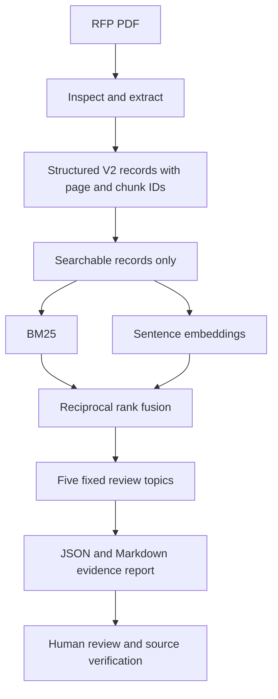

# BidLens — Evidence-Grounded RFP Review

**Portfolio project | Python 3.12 | PDF ingestion | Hybrid retrieval | Evaluation**

BidLens is a local, reproducible demonstration of evidence discovery in complex IT procurement RFPs. It extracts structured, page-referenced passages from PDFs, retrieves relevant evidence using BM25 and sentence embeddings, and creates a human-reviewable report with source citations.

> **Scope boundary:** BidLens does not certify requirements, assess a vendor's compliance, or make bid/no-bid decisions. Retrieved evidence is a candidate for human review. No vendor capability documents are provided in the sample.

## Why this project?

Enterprise RFPs mix eligibility criteria, functional requirements, technical protocols, reporting obligations and security controls across narrative sections and tables. A useful AI assistant must locate supporting evidence and know when it cannot make a justified determination.

## Demonstration

The sample review searches five fixed topics: **eligibility, scope, integration, reporting, security**. It outputs `assessment.json` and `assessment.md`, each with source page numbers and chunk identifiers. The sample report has 15 citations across five sections. **Security evidence is a known weakness:** the current top results are largely annexure headings and index references, not substantive controls. Do not treat this section as a validated security review.

Example retrieved evidence from the sample document:

| Topic | Example passage | Source |
|---|---|---|
| Eligibility | INR 20 crore annual turnover in India for each of three specified financial years | p. 12, `cbi_upi_rfp:p0012:elig003` |
| Integration | Interfaces using ISO 8583/ISO 20022, web services, MQ, XML and APIs | p. 34, `cbi_upi_rfp:p0034:n006` |
| Reporting | Transaction and channel-wise reporting, reconciliation and risk reporting | p. 38, `cbi_upi_rfp:p0038:n005` and `...:n006` |

These are **human-reviewed examples from the generated retrieval report**, not an automatically generated compliance verdict.

## Architecture



## Quick start (Windows PowerShell)

Requires Python 3.12, an existing project checkout, the V2 JSONL data and the demo script from the portfolio MVP patch.

```powershell
py -3.12 -m venv .venv
.\.venv\Scripts\Activate.ps1
python -m pip install -r requirements.txt
python -m pip install -e .
python -m pytest tests/test_demo_assessment.py -q
python scripts/demo_assessment.py --root . --output-dir demo_output
python scripts/validate_demo.py --report demo_output/assessment.json --chunks data/processed/cbi_upi_rfp_v2.jsonl
```

The embedding model (`sentence-transformers/all-MiniLM-L6-v2`) may download on the first run. The demo uses **V2 hybrid retrieval (BM25 + semantic reciprocal rank fusion)**. The validation command checks source record IDs, page metadata, exact extracted text and the explicit abstention status. It **does not** verify that a passage truly supports a requirement or that the original PDF was extracted correctly.

## Evaluation and engineering findings

Across 16 review questions and **42 provisionally mapped evidence facets**, at a 4,000-token context budget, V2 hybrid retrieved **33/42 facets (78.6%)**, with all mapped facets present for **10/16 questions**. In the Day 3.6 comparison, reranking also retrieved 33/42 facets, but only 9/16 questions were complete; same-page context expansion did not consistently improve results. These are **mapped-facet hit rates**, *not certified recall, accuracy or compliance scores*. The 42 mappings are not exhaustive relevance judgments.

This project's central engineering lesson: **more sophisticated ranking does not necessarily produce more complete evidence coverage**.

## Repository guide

- `src/bidlens/`: PDF extraction, structured ingestion and retrieval modules
- `scripts/`: ingestion, search, evaluation and portfolio demo entry points
- `tests/`: extraction, retrieval and demo tests
- `evaluation/`: question set, rubric and experiment artifacts
- `docs/`: architecture, evaluation findings and portfolio case study
- `demo_output/`: generated local artifacts (publish only after source-rights review)

## Experiments

Historical ingestion, eligibility, retrieval and failure-analysis scripts are preserved under `experiments/`. See the [experiment guide](experiments/README.md) for original-to-current paths, dataset requirements, reproduction commands and evaluation limitations. Active entry points remain in `scripts/`; historical results remain in `evaluation/results/`.

## Limitations

- Five fixed searches are **not exhaustive requirement extraction**.
- Results include low-information passages such as glossary entries and annexure headings.
- Security results in the current sample do not establish substantive security coverage.
- No vendor evidence is supplied; vendor compliance is **UNKNOWN** and bid decision **NOT ASSESSED**.
- Evidence citation integrity is not the same as semantic correctness.
- Source document permissions must be checked before publishing the PDF or extracted text.
- No hosted deployment, authentication, production monitoring or procurement certification is claimed.

## Reproducibility and provenance

Record the exact PDF edition, checksum, extraction configuration, model identifier and local environment when reproducing results. See `sources.json` for the project's document registry. The sample analysis is based on a Central Bank of India UPI RFP; confirm redistribution rights before committing any full document or derived passages to a public repository.

## What I learned

How to structure difficult PDF evidence, combine lexical and semantic search, evaluate retrieval at fixed context budgets, interpret negative experiments, validate provenance and avoid unsupported business conclusions. See [`docs/ENGINEERING_CASE_STUDY.md`](docs/ENGINEERING_CASE_STUDY.md).

## Status

**Portfolio demonstration — final verification and publication review.** Retrieval experiments are frozen. This is an educational engineering artifact, not a production compliance system.
