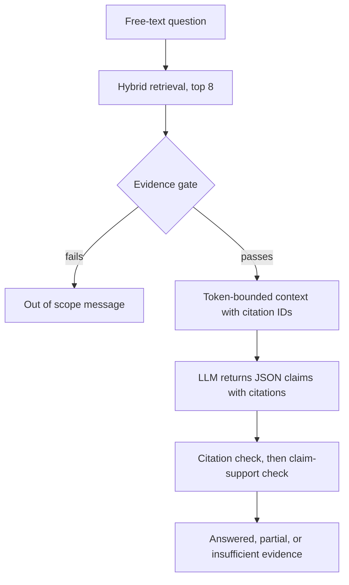
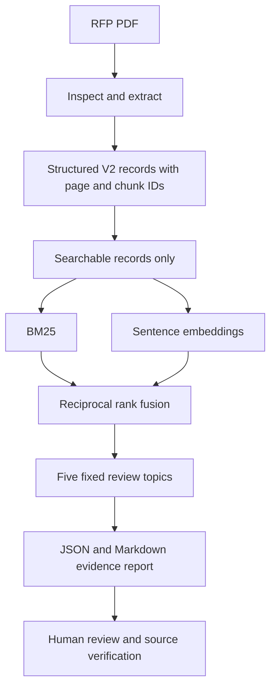

# BidLens — Evidence-Grounded RFP Review

**Portfolio engineering project | Python 3.12 | structured PDF ingestion | hybrid retrieval | evidence-grounded RAG | Streamlit | evaluation**

> **Status (November 2026):** Phase 2 portfolio milestone. Functional prototype with recorded single-document evaluation, not a production procurement, compliance or bid-decision system.

BidLens is a local, reproducible demonstration of evidence discovery in complex IT procurement RFPs. It extracts structured, page-referenced passages from PDFs, retrieves relevant evidence using BM25 and sentence embeddings, and creates a human-reviewable report with source citations. **Phase 2** adds grounded question answering: free-text questions are answered only from retrieved passages, every statement carries a verified citation, and the system says so when the document does not contain the answer.

> **Scope boundary:** BidLens does not certify requirements, assess a vendor's compliance, or make bid/no-bid decisions. Retrieved evidence is a candidate for human review. No vendor capability documents are provided in the sample.

## Why this project?

Enterprise RFPs mix eligibility criteria, functional requirements, technical protocols, reporting obligations and security controls across narrative sections and tables. A useful AI assistant must locate supporting evidence and know when it cannot make a justified determination.

## Demonstration

The sample review searches five fixed topics: **eligibility, scope, integration, reporting, security**. It outputs `assessment.json` and `assessment.md`, each with source page numbers and chunk identifiers. The sample report has 15 citations across five sections. **Security evidence is a known weakness:** the current top results are largely annexure headings and index references, not substantive controls. Do not treat this section as a validated security review.

Example retrieved evidence from the sample document:

| Topic | Example passage | Source |
|---|---|---|
| Eligibility | INR 20 crore annual turnover in India for each of three specified financial years | p. 12, `cbi_upi_rfp:p0012:elig003` |
| Integration | Interfaces using ISO 8583/ISO 20022, web services, MQ, XML and APIs | p. 34, `cbi_upi_rfp:p0034:n006` |
| Reporting | Transaction and channel-wise reporting, reconciliation and risk reporting | p. 38, `cbi_upi_rfp:p0038:n005` and `...:n006` |

These are **human-reviewed examples from the generated retrieval report**, not an automatically generated compliance verdict.

## Grounded Q&A (Phase 2)

Ask any question about the RFP. BidLens retrieves evidence, checks whether it is sufficient, generates an answer constrained to cited passages, then removes anything it cannot verify. Out-of-scope questions get a plain explanation instead of a guess.



| Layer | Catches | Does not catch |
|---|---|---|
| Evidence gate (semantic similarity and query-term coverage) | Off-topic questions | Plausible questions the document does not answer |
| Model abstention | Answer absent from retrieved passages | Model ignoring the instruction |
| Citation check | Claims citing passages that were not in the context | An irrelevant but real citation |
| Claim-support check (figures and term overlap; optional LLM judge) | Invented numbers, unsupported claims | Subtle entailment errors such as negation |

Each layer can only remove content. Retrieved text is passed to the model as untrusted data. Model runtimes sit behind one adapter: **local Ollama by default**, with opt-in OpenAI and Gemini (these send retrieved RFP passages to an external API). Details and configuration: [`docs/PHASE2.md`](docs/PHASE2.md).

## System architecture and data flow

The ingestion path runs offline. The question-answering path consumes the searchable V2 records, not the raw PDF. This separation makes extraction errors inspectable before generation.

```mermaid
flowchart LR
    PDF[RFP PDF] --> EX[PyMuPDF narrative + table extraction]
    EX --> CL[Conservative cleanup and first-row recovery]
    CL --> EN[Enrichment + quality flags]
    EN --> DB[(V2 JSONL: page-linked records)]
    DB --> IDX[BM25 + MiniLM embeddings]
    IDX --> RRF[Reciprocal rank fusion]
    RRF --> G{Relevance gate}
    G -- fails --> AB[Abstain]
    G -- passes --> CTX[Bounded cited passages]
    CTX --> LLM[Ollama / OpenAI / Gemini]
    LLM --> CH[JSON claims + citation resolution]
    CH --> SUP[Numeric and term-overlap support screen]
    SUP --> OUT[Answer / partial / insufficient]
```



### Key design trade-offs

| Choice | Reason | Consequence |
|---|---|---|
| Page-linked table/eligibility records | Preserve procurement structure | Some document-specific extraction heuristics remain |
| BM25 + MiniLM + RRF | Balance exact identifiers and paraphrases without score normalization | Rank fusion does not provide calibrated confidence |
| Token-bounded top-ranked passages | Control context size and latency | Can omit evidence needed for complete answers |
| Citation-ID checks and support screen | Reject invented IDs and some unsupported statements | Does not prove entailment, especially negation or conditions |
| Local Ollama default | Avoid sending retrieved RFP text to cloud services | Local model latency and resource requirements |
| Human review instead of compliance decisions | No vendor-response evidence in the sample | Not a bid/no-bid engine |

### Evidence-discovery report architecture



## Reproducibility: from a clean checkout

**The source PDF and generated V2 JSONL are intentionally not committed.** Obtain the RFP from the URL in [`sources.json`](sources.json), verify the edition and permissions, and place it at `data/raw/cbi_upi_rfp.pdf`. Some ingestion heuristics and checks are specific to this 147-page RFP. The first semantic run may download model weights.

## Quick start (Windows PowerShell)

Run from `projects/bidlens/`. Requires Python 3.12, the source PDF above, and an available Python environment. The commands below regenerate V2 rather than assuming ignored data is already present.

```powershell
py -3.12 -m venv .venv
.\.venv\Scripts\Activate.ps1
python -m pip install -r requirements.txt -r requirements-phase2.txt
python -m pip install -e .
python scripts/ingest_rfp_v2.py --pdf data/raw/cbi_upi_rfp.pdf --output data/processed/cbi_upi_rfp_v2.jsonl --report evaluation/results/ingestion_v2_report.json
python -m pytest tests -q -rs
python scripts/demo_assessment.py --root . --output-dir demo_output
python scripts/validate_demo.py --report demo_output/assessment.json --chunks data/processed/cbi_upi_rfp_v2.jsonl
```

The embedding model (`sentence-transformers/all-MiniLM-L6-v2`) may download on the first run. The demo uses **V2 hybrid retrieval (BM25 + semantic reciprocal rank fusion)**. The validation command checks source record IDs, page metadata, exact extracted text and the explicit abstention status. It **does not** verify that a passage truly supports a requirement or that the original PDF was extracted correctly.

## Running Phase 2 (local Ollama or opt-in cloud providers)

```powershell
python -m pip install -r requirements.txt -r requirements-phase2.txt
python scripts/calibrate_gate.py                      # inspect gate signals on the question set
python scripts/ask.py "What minimum annual turnover must a bidder demonstrate?"
python scripts/evaluate_qa.py --provider ollama       # writes evaluation/results/phase2/qa_eval_*.json
streamlit run app/streamlit_app.py
```

To inspect truncated model output locally, set `BIDLENS_DEBUG_DIR=evaluation/results/phase2/debug` (dumps contain RFP text and are git-ignored).

For a cloud runtime, set `OPENAI_API_KEY` or `GEMINI_API_KEY` and pass `--provider openai|gemini` (or choose it in the app sidebar). `python scripts/check_llm.py --provider gemini` tests connectivity without sending RFP text.

## How to review the outputs

Each answer includes an outcome, claim text, citation IDs and the retrieved passages. Citation integrity means that an ID was supplied to the model; it does **not** establish that the cited sentence entails the claim. `ANSWERED` means the implemented screens passed, not that the answer is certified correct or complete. `PARTIAL` means some claims were removed or output was recovered after truncation. `INSUFFICIENT_EVIDENCE` can also appear on error paths; inspect `outcome` and `reason` together.

The original five-topic report is **retrieval-only** and must not be confused with LLM question answering. Neither workflow assesses vendor compliance.

## Evaluation and engineering findings

Across 16 review questions and **42 provisionally mapped evidence facets**, at a 4,000-token context budget, V2 hybrid retrieved **33/42 facets (78.6%)**, with all mapped facets present for **10/16 questions**. In the Day 3.6 comparison, reranking also retrieved 33/42 facets, but only 9/16 questions were complete; same-page context expansion did not consistently improve results. These are **mapped-facet hit rates**, *not certified recall, accuracy or compliance scores*. The 42 mappings are not exhaustive relevance judgments.

This project's central engineering lesson: **more sophisticated ranking does not necessarily produce more complete evidence coverage**.

### Phase 2 question answering: two graded runs

Both runs use the same 20 questions (16 answerable, 4 unanswerable with absence not fully audited), Llama 3.1 8B via Ollama, the same provisional gate thresholds (0.30 similarity, 0.50 coverage) and one reviewer. Counts, not rates:

| Measure | Run 1 (before fixes) | Run 2 (after fixes) |
|---|---|---|
| Answerable questions answered | 6/16 (5 full, 1 partial) | 16/16 (12 full, 4 partial) |
| Answerable questions where the system abstained | 10/16 | 0/16 |
| Operational errors (parse failure, truncation) | 4 | 0 |
| Unanswerable questions correctly abstained | 4/4 (1 gate, 3 model) | 4/4 (1 gate, 3 model) |
| Answerable questions blocked by the gate | 0/16 | 0/16 |
| Provisional gold evidence in retrieved context | 14/16 | 14/16 |
| Provisional gold evidence cited in the answer | 5/16 | 14/16 |
| Claims removed by verification | 20 (19 were a citation-format fault) | 5 (3 figure mismatches, 2 term-overlap) |
| Human grade of displayed answers | all surviving claims supported; 5 correct, 1 partial | all surviving claims supported; 16 correct |
| Median total latency | about 40 s | about 48 s (answered questions only) |

**What changed between runs.** Run 1's ten over-abstentions were implementation faults rather than retrieval or knowledge failures: six were citations written as `<passage id="...">` that strict validation rejected, and four were JSON replies cut off at the output limit. The fixes were tolerant citation parsing (the ID must still be a passage that was sent), an explicit 8,192-token Ollama context window, a shorter answer format (at most six one-sentence claims), schema-constrained decoding on Ollama, one retry with a tighter prompt on truncation, collapsing of duplicate claims, and explicit errors instead of broken JSON. No truncation or retry occurred in Run 2; this run does not show which of the fixes prevented it. Latency rose because more questions now produce full answers.

**How to read Run 2.**

- **It is in-sample.** The fixes were made after seeing Run 1's failures on these same questions, so Run 2 shows that those faults are gone, not how the system performs on new questions. A held-out adversarial set (contradictions, absent evidence) is the planned test.
- **Correct is not the same as complete.** Ten of the 16 answerable questions reached the six-claim limit in the prompt. Whether that limit drops required facets has not been checked against the rubric's per-question facets.
- **Verification has a recall cost that is not yet graded.** The five removed claims include the earnest-money amount in Q004 (rejected as "figure not in cited text"), list-number figures in Q005, and two paraphrases rejected for low term overlap. Whether each removal was correct has not been reviewed.
- **Gold evidence is provisional.** Q002 and Q012 were graded correct although the mapped gold passage was not in context, which suggests the mapping is incomplete.
- **Small and single-source.** One RFP, 20 questions, one reviewer, and absence of evidence for the four unanswerable questions is not fully audited. Median latency covers answered questions only because abstention paths do not yet record total time, and hardware is not specified.

## Repository guide

- `src/bidlens/`: PDF extraction, structured ingestion, retrieval, and Phase 2 modules (`gate.py`, `answering.py`, `llm.py`, `runtime.py`)
- `scripts/`: ingestion, search, evaluation and portfolio demo entry points; Phase 2 adds `ask.py`, `calibrate_gate.py`, `evaluate_qa.py`, `check_llm.py`
- `app/`: Streamlit question-answering demo
- `tests/`: extraction, retrieval, demo and Phase 2 tests
- `evaluation/`: question set, rubric and experiment artifacts
- `docs/`: architecture, evaluation findings and portfolio case study
- `demo_output/`: generated local artifacts (publish only after source-rights review)

## Experiments

Historical ingestion, eligibility, retrieval and failure-analysis scripts are preserved under `experiments/`. See the [experiment guide](experiments/README.md) for original-to-current paths, dataset requirements, reproduction commands and evaluation limitations. Active entry points remain in `scripts/`; historical results remain in `evaluation/results/`.

## Peer-review checklist

- [ ] Verify PDF provenance and rights before redistributing source passages.
- [ ] Rebuild V2 records; inspect ingestion acceptance checks and extraction warnings.
- [ ] Run `python -m pytest tests -q -rs` and record any skipped tests.
- [ ] Run CLI and Streamlit on the same V2 corpus and record model versions, hardware and environment.
- [ ] Inspect source PDF pages for cited tables and continuation rows.
- [ ] Challenge Q002, Q012, rejected claims and negative/contradictory questions.
- [ ] Distinguish in-sample human grades from independent correctness and completeness testing.
- [ ] Ensure no API keys, private PDFs or debug dumps are committed.

## Limitations

- Five fixed searches are **not exhaustive requirement extraction**.
- Results include low-information passages such as glossary entries and annexure headings.
- Security results in the current sample do not establish substantive security coverage.
- No vendor evidence is supplied; vendor compliance is **UNKNOWN** and bid decision **NOT ASSESSED**.
- Evidence citation integrity is not the same as semantic correctness.
- Generated answers come from a language model. The support check is a screen, not proof of entailment, and the evidence gate is a heuristic: it can misjudge vague but legitimate questions.
- Gate thresholds are provisional, and Phase 2 is evaluated on a single RFP with an in-sample question set.
- Cloud runtimes (OpenAI, Gemini) send retrieved RFP passages to an external service; local Ollama does not.
- Source document permissions must be checked before publishing the PDF or extracted text.
- No hosted deployment, authentication, production monitoring or procurement certification is claimed.

## Reproducibility and provenance

Record the exact PDF edition, checksum, extraction configuration, model identifier and local environment when reproducing results. See `sources.json` for the project's document registry. The sample analysis is based on a Central Bank of India UPI RFP; confirm redistribution rights before committing any full document or derived passages to a public repository.

## What I learned

How to structure difficult PDF evidence, combine lexical and semantic search, evaluate retrieval at fixed context budgets, interpret negative experiments, validate provenance and avoid unsupported business conclusions. See [`docs/ENGINEERING_CASE_STUDY.md`](docs/ENGINEERING_CASE_STUDY.md).

## Status

**Portfolio demonstration — Phase 2 (grounded Q&A) implemented; two graded runs recorded; held-out adversarial evaluation pending.** Retrieval experiments are frozen. This is an educational engineering artifact, not a production compliance system.
